<a href="https://easytractai.com">
  <picture>
    <source media="(prefers-color-scheme: dark)" srcset="assets/hero-dark.svg">
    
  </picture>
</a>

 
 

 

### Gaps in the job file show up when it's too late to fix them

A skipped photo or reading usually goes unnoticed until the adjuster asks. By then drying is finished, the equipment is gone, and there's no going back for it. EasyTract checks every active job every day, so the gap gets caught while the crew is still on site.

| | Without EasyTract | With EasyTract |
| :-- | :-- | :-- |
| **When gaps are found** | When the adjuster asks | The same day |
| **Who finds them** | The adjuster | Your crew, while they can still go back |
| **Office time** | Combing through files and calling techs | Flags for every active job, every day |
| **Payment** | Cut line items and files stuck in review | Proof of work is in the file |

 

### How it works

<picture>
  <source media="(prefers-color-scheme: dark)" srcset="assets/flow-dark.svg">
  
</picture>

 
 

### Built for the whole mitigation team

<table>
  <tr>
    <td width="33%" valign="top">
      <b>Owners</b> 
      Missing proof of work means cut line items and files stuck in review. That delays payment.
    </td>
    <td width="33%" valign="top">
      <b>Mitigation managers</b> 
      See gaps on active jobs before the job closes, not after.
    </td>
    <td width="33%" valign="top">
      <b>Office staff</b> 
      Less time combing through files and calling techs. Fewer things slip through.
    </td>
  </tr>
</table>

 

### FAQ

<b>Do my techs need to change how they work?</b>

 
No. They keep documenting in Encircle the way they do now. EasyTract reads the jobs from there.
  

<b>What does EasyTract check?</b>

 
The photos, moisture readings, and equipment logs expected for each day of drying, on every active job.
  

<b>When do gaps get flagged?</b>

 
The same day, while the crew can still go back and fix them.
  

<b>Who's behind EasyTract?</b>

 
Grant Gatch and Noah Shewell, based in Salt Lake City and part of the University of Utah's Sandbox accelerator.
  

 

 
 

**Grant Gatch** · Co-founder, customers and partnerships · [grant@easytractai.com](mailto:grant@easytractai.com) · [LinkedIn](https://www.linkedin.com/in/grant-gatch/) 
**Noah Shewell** · Co-founder, product and engineering · [noah@easytractai.com](mailto:noah@easytractai.com) · [LinkedIn](https://www.linkedin.com/in/noah-shewell/)

 

© 2026 EasyTract Technologies · Salt Lake City, UT

