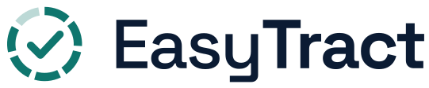

 

<picture>
  <source media="(prefers-color-scheme: dark)" srcset="assets/logo-dark.svg">
  
</picture>

 
 

**AI vision for tunnel car washes.**

EasyTract is using AI vision to automate aftermarket part detection in car wash tunnels before contact, increasing throughput and retract consistency while reducing vehicle damage.

 

 

---

 

`DETECT` → `CONFIRM` → `RETRACT`

Milliseconds · One glance · In time

 

---

### What it does
Detects aftermarket parts on vehicles entering a wash tunnel and flags them to the operator before the vehicle reaches retractable equipment.

### Why it matters
Retracts depend on someone noticing in time. Missed calls are the main source of avoidable damage in a tunnel.

### How the decision works  
The operator confirms every detection. Nothing retracts automatically. We automate the watching; the judgment stays with the operator.

 

Repositories are private while patent questions are open. 
Operators, investors, and the pilot-curious — we'd like to hear from you.

 
 

**Noah Shewell** · **Grant Gatch** — Salt Lake City, Utah

 

